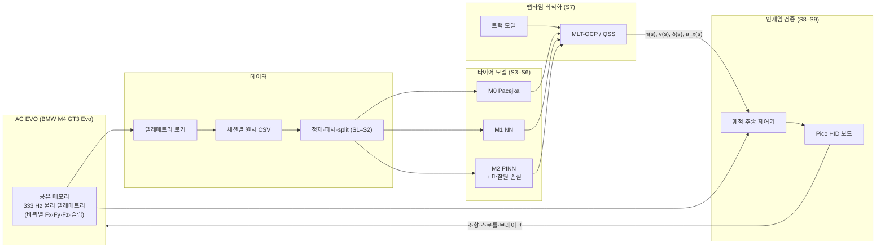
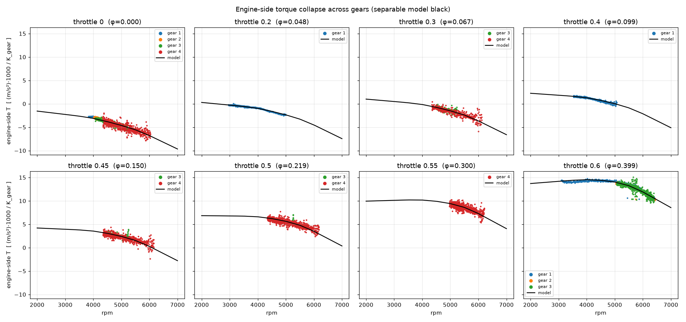
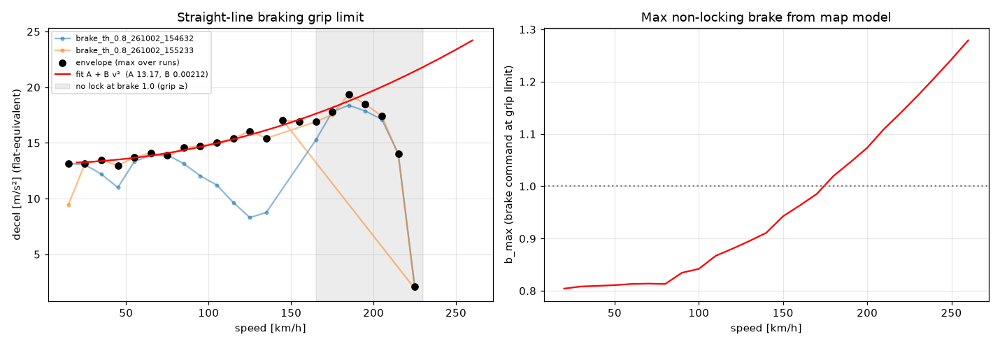
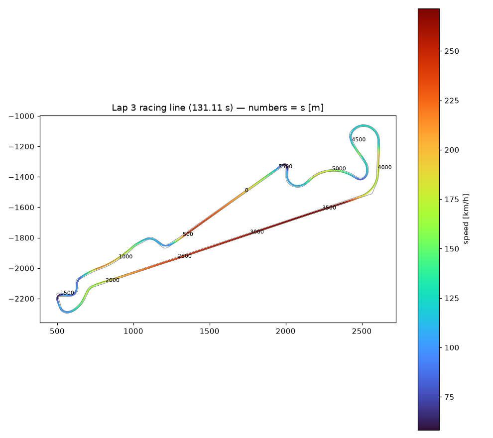
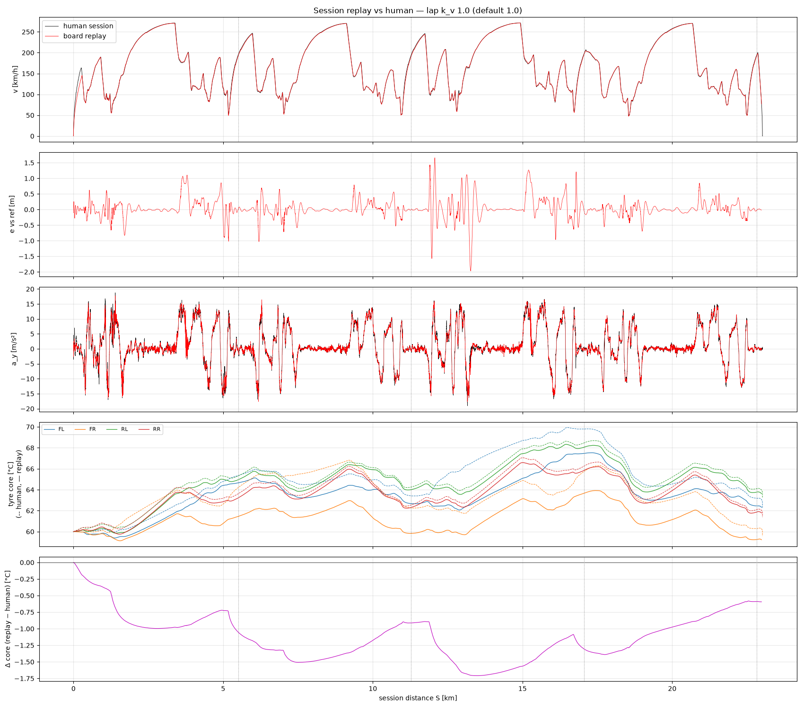
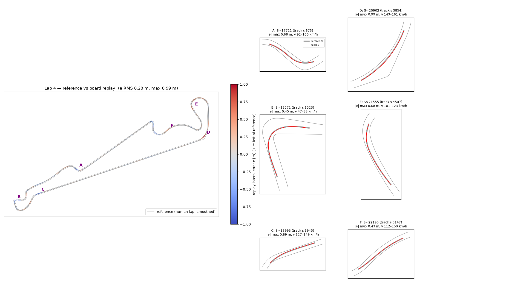
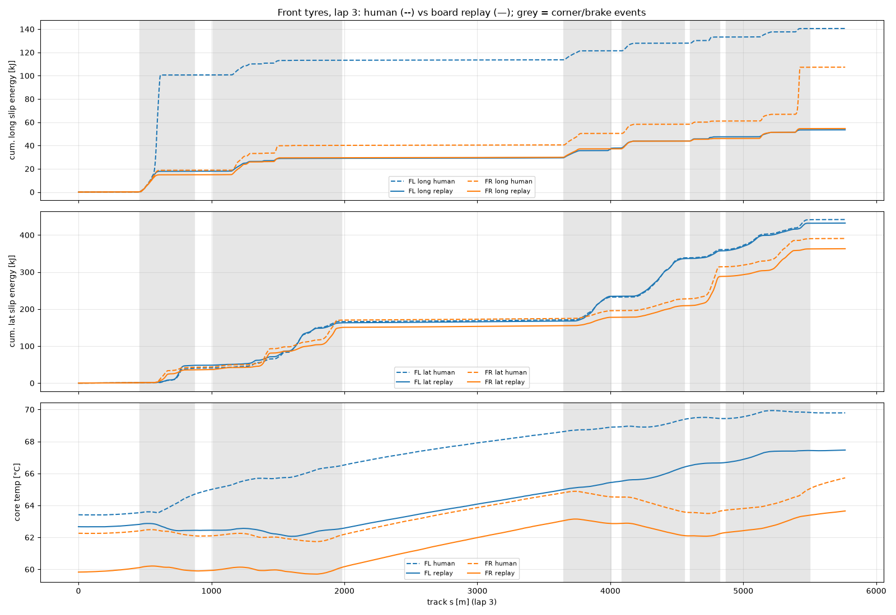

# PINN 기반 타이어 모델 — 레이싱 시뮬레이터 차량동역학 연구

Assetto Corsa EVO 텔레메트리로 **물리 정보 신경망(PINN) 타이어 모델**을 학습하고, 그 모델로 랩타임 최적화(MLT-OCP)와
인게임 주행 검증까지 가는 차량동역학 연구입니다. 세종대학교 지능기전공학부 IVL.
1차 마일스톤은 2026년 11월 KSAE 추계학술대회 포스터, 이후 석사 논문으로 확장합니다.

> 이 저장소는 **프로젝트 소개용**입니다. 코드·데이터·설계 문서는 별도 비공개 저장소에서 관리합니다.

> **핵심 주장** — 마찰원(friction circle) 물리 제약을 손실함수에 넣으면, 학습 데이터가 없는 한계 영역에서
> 타이어 모델 정확도가 높아진다.

| 라벨 | 모델 | 역할 |
|---|---|---|
| **M0** | Pacejka Magic Formula 피팅 | 해석적 baseline |
| **M1** | 순수 신경망 (물리 손실 없음) | 데이터 기반 baseline |
| **M2** | PINN (마찰원 물리 손실 포함) | 제안 모델 |

---

## 한눈에 보는 진행 상황 (2026-10-30 기준)

| 단계 | 내용 | 상태 |
|---|---|---|
| S0 | 환경 셋업 — 텔레메트리 로거, 트랙 모델, 제어 주입 보드 | ✅ 완료 |
| S1 | 데이터 수집 + 정제 | 🔄 진행 중 — 수집 프로토콜·도구 확보, 본 수집 전 |
| S2 | 피처·split 설계 | ⏳ 예정 (홀드아웃 규칙은 확정) |
| S3 | M0 Pacejka fitting | 🔄 진단 스크립트 작성, 파일럿 데이터 대기 |
| S4–S5 | M1 / M2 학습 | ⏳ 예정 |
| S6 | Ablation 평가 | ⏳ 예정 |
| S7 | QSS 랩타임 검증 | ⏳ 예정 |
| S8 | 종방향 제어기 | ✅ 맵 측정·FF 역변환·직선 추종 검증 완료 |
| S9 | 인게임 폐루프 검증 | ✅ 제어기 확보 — 사람 4랩 세션을 100 % 페이스로 재현 (랩당 +0.5 s) |

**지금까지의 주요 결과**

- Pico 기반 HID 보드로 PC가 게임에 조향·스로틀·브레이크를 333 Hz로 주입 (16 bit, 1 물리 틱 이내 반영, 안전 로직 포함)
- 종방향 맵: 엔진토크 분리형 모델 하나로 기어 2~6단 데이터를 통합, 잔차 RMS **0.074 m/s²**
- 직진 제동 접지 한계와 횡방향 한계가 거의 같음 → **마찰원이 거의 원형** (`a_lim ≈ 13.2 + 0.0021·v²`, `a_y,max ≈ 12.8 + 0.0024·v²`)
- 궤적 추종: 사람 세션(피트 출구 → 아웃랩 + 3랩, 23 km)을 **100 % 속도로 재현**, 횡오차 RMS **0.33 m**, 랩타임 **+0.5 s**
- 같은 궤적·같은 랩타임이어도 **짧은 앞바퀴 잠김 한 번이 타이어 코어 온도를 1~3 °C 바꿈** (사람 vs 보드 재현 발열 비교)

---

## 전체 파이프라인



**연구 설계 포인트** — S9에서 추종 제어기의 피드포워드는 각 타이어 모델(M0/M1/M2)로 푼 OCP 해에서 나옵니다.
같은 제어기·같은 마찰 마진에서 **랩타임과 피드백 보정량**이 곧 타이어 모델 정확도 지표가 됩니다.
현재는 OCP 해 대신 **사람 랩에서 OCP 해와 같은 형태의 정보(n(s), v(s), δ(s), a_x(s))만 뽑아** 제어기를 검증했습니다.

---

## 플랫폼과 실험 조건

| 항목 | 값 |
|---|---|
| 시뮬레이터 | Assetto Corsa EVO v0.8 (Early Access) |
| 차량 | BMW M4 GT3 Evo (후륜구동, 자동 변속) |
| 트랙 | Paul Ricard (학습) · Nordschleife / Sebring (OOD 검증 후보) |
| 텔레메트리 | 공유 메모리, 800 B, 333 Hz |
| 선정 이유 | 바퀴별 Fx/Fy를 **N 단위로 직접 제공** — 실차라면 flat-trac 시험기가 필요한 데이터를 주행으로 얻음 |
| 조건 | TC 0 · ABS 0 · Stability 0 · 날씨 Clear 고정 · 셋업 고정 |

---

## 파트별 세부 내용

### 1. 텔레메트리 로거

- 게임 물리 구조체를 ctypes로 읽어 **원시 스냅샷을 손실 없이** CSV로 저장 (피처 선택은 전부 후처리)
- 축 규약은 공식 문서가 아니라 실측으로 확정: `accG = [lateral, vertical, longitudinal]`, `localVelocity = [vy, vz, vx]`,
  yaw rate = `localAngularVel_1`, heading 증가 = 우회전

### 2. 트랙 모델

- 게임 패키지에서 AI 라인·흰 선·연석 메시를 추출해 **폐곡선 기준선(1 m) + 좌우 폭 + 곡률 κ, 경사**를 만듦
- 텔레메트리 접지점과 좌표계 정합 확인 (노면 높이 잔차 중앙값 1–3 mm)
- 추종 제어기와 기준 궤적 추출은 이 트랙 모델의 **연속 투영**(s, n)을 공통 좌표로 사용

### 3. 제어 주입 보드

PC가 게임에 연속 입력을 넣기 위한 USB HID 보드. 사람 손으로 불가능한 표준 기동(pulse steer, steer chirp)과
OCP 해 주행을 위해 만들었습니다.

- **하드웨어**: Raspberry Pi Pico (RP2040), Pico SDK + TinyUSB, HID 조이스틱(조향·스로틀·브레이크 16 bit) + CDC 시리얼 복합 장치
- **링크**: PC→보드 11 B 프레임(CRC-8/SMBUS), 보드→PC 상태 프레임, 333 Hz
- **안전 로직**: armed 게이트(0→1 에지로만 활성), 물리 E-stop(래치·2 s 재누름 해제), 통신 워치독 200 ms, 하드웨어 워치독 100 ms
- **검증**: 게임 입력 해상도(1/20000), 1 물리 틱 이내 반영, 필터 없음 확인, 안전 로직 시험

### 4. 종방향 맵

보드로 직선에서 스로틀·코스트·브레이크를 정해진 값으로 넣고 가감속을 측정해, 페달 → 가속도 맵을 만들었습니다.
측정 중 직진 유지는 트랙 모델 기반 차선 유지 조향, 안전은 휠스핀·잠김·경계 감시가 담당합니다.

```
a·(1 + λK²) + g·grade = −(c0 + c2·v²) + K·[T0(rpm) + φ(p)·(T1(rpm) − T0(rpm))]/1000 − kb·b
```

- 여러 기어 데이터가 **하나의 엔진측 토크 곡선**으로 모임 → 측정 안 한 (기어, 페달) 조합도 예측
- 스로틀은 강한 비선형: φ(0.4) = 0.10, φ(0.6) = 0.40, φ(0.8) = 0.65 — 표본 외 예측 오차 ≤ 0.016
- 브레이크는 선형(16.6 m/s² / 페달), 자동 변속은 페달과 무관한 **속도 히스테리시스**
- 잠김 한계 추종 제동(ABS 덤프 방식)으로 속도별 **직진 접지 한계** 측정





### 5. 피드포워드 모듈

목표 가속도 → (스로틀, 브레이크) 역변환. 접지 한계(b_max), 저단 휠스핀 상한, 클러치 구간, 포화를 처리하고
런타임 잠김 보호를 포함합니다. 직선 가상 속도 프로파일 추종에서 FF 단독 속도 오차 RMS 1.4 km/h,
FF + PI 0.65 km/h.

### 6. 기준 궤적 추출

사람 주행 로그에서 **OCP 해와 같은 형태의 정보만** 뽑아 기준 궤적을 만듭니다(녹화된 페달·조향 원값은 재생하지 않음).

- 1 m 격자로 n(s), v(s), a_x(s), a_y(s), **앞바퀴각 δ(s)**(바퀴 접지 방향에서 직접 측정), 곡률, 기어
- 세션 전체(피트 출구 정지 → 아웃랩 → 2·3·4랩)를 누적거리 S 하나로 잇는 세션 기준도 생성
- 진단: 조향비 17.9°/unit(속도 의존 18.0 → 17.5), 사람 랩 횡방향 한계 포락선, 코너링 저항, 언더스티어 경사



### 7. 궤적 추종 제어기

**피드포워드(s 인덱스) + 전방주시 피드백** 구조입니다.

- **횡방향**: FF = 기준 앞바퀴각 δ(s + 미리보기) ÷ 속도 의존 조향비, FB = 기준 경로 대비 횡오차·heading 오차 cascade(±4°) + yaw rate 감쇠
- **종방향**: FF = a_x(s + 미리보기) → 맵 역변환, FB = 속도 PI
- **접지 한계 보호**: 속도 의존 마찰타원(제동·구동 양쪽), 후륜 구동 슬립 제한, 잠김 보호, 미끄러짐 시 완만한 리프트
- **안전 중단**: 기준 이탈 3 m, heading 15°, 차체 슬립각 8°, 휠스핀, 트랙 이탈, 텔레메트리 정지 → 조향 추종을 유지하며 정지

| 시험 | 결과 |
|---|---|
| 3랩 기준, 속도 70 % / 85 % | 횡오차 RMS 0.27 / 0.31 m |
| 세션 재현, 전 랩 100 % (23 km) | 횡오차 RMS 0.33 m, 최대 1.97 m · 랩타임 사람 대비 +0.5 s · 잠김 0회 |
| 타이어 코어 온도(랩 평균) | 뒷바퀴 ±0.5 °C, 앞바퀴 1~3 °C 낮음 |





### 8. 타이어 발열 분석

사람과 보드 재현의 바퀴별 미끄럼 일률(|F|·미끄럼 속도)을 같은 S 축에서 비교했습니다.
코너링(횡방향) 발열은 2~7 % 차이로 거의 같고, 차이는 **사람의 짧은 앞바퀴 잠김 3회**(최대 100 kW, 회당 35~83 kJ)에서
나옵니다. 보드 재현은 잠김 보호 때문에 잠기지 않습니다.
→ 사람 데이터에는 슬립률 −1(피크 이후 미끄럼) 샘플이 있고 재현 데이터에는 없다는 점이 학습 데이터 설계에 영향을 줍니다.



### 9. 타이어 모델

- **M0 진단**: EVO 내부 타이어 모델이 Pacejka 계열이면 M0가 너무 강해져 비교가 무의미해집니다.
  pure slip 데이터에 MF를 피팅해 잔차 구조를 먼저 확인하는 진단 스크립트를 작성했습니다.
- M1·M2 학습(MATLAB Deep Learning Toolbox, dlarray/dlgradient)은 S2 이후 진행합니다.
  M2 학습 시 **물리 손실이 활성화된 샘플 비율을 반드시 로깅**합니다(hinge 형태라 원 안쪽 예측에서는 gradient가 0).

---

## 툴체인

| 역할 | 도구 |
|---|---|
| 텔레메트리 수집·전처리·제어 | Python 3.12 (numpy, pandas, matplotlib, pyserial) |
| PINN 학습 (M0/M1/M2) | MATLAB Deep Learning Toolbox |
| MLT-OCP | CasADi / fmincon (MATLAB) |
| 제어 보드 | Raspberry Pi Pico (RP2040), Pico SDK 2.x + TinyUSB |

## 데이터 원칙

- 원시 CSV(333 Hz)는 랩당 수십 MB라 저장소에 올리지 않습니다.
- **홀드아웃 세션은 물리적으로 분리된 경로**에 두고, 학습 코드는 이 경로를 읽지 않습니다(사후 필터링이 아니라 경로 분리).

## 다음 단계

1. S1 본 수집: 표준 기동 + 랩 주행을 보드로 통제 수집 (타이어 압력·연료를 실험 축으로)
2. 파일럿 데이터로 M0 진단 → M0/M1/M2 비교 구조 유효성 확인
3. 앞바퀴 잠김(피크 이후) 영역을 학습 데이터에 어떻게 포함할지 결정
4. OCP 해를 추종 제어기에 넣어 S9 검증 (FB 보정량 = 모델 정확도 지표)
